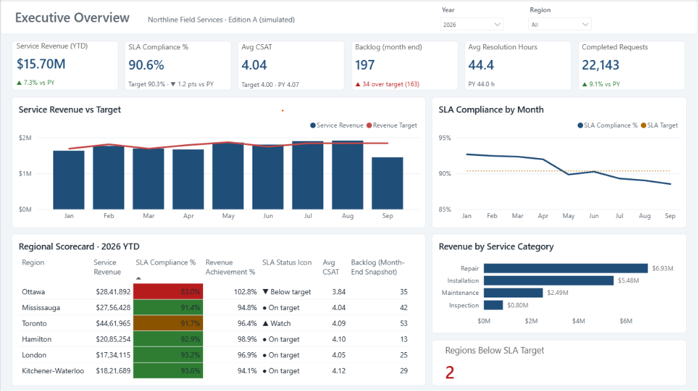
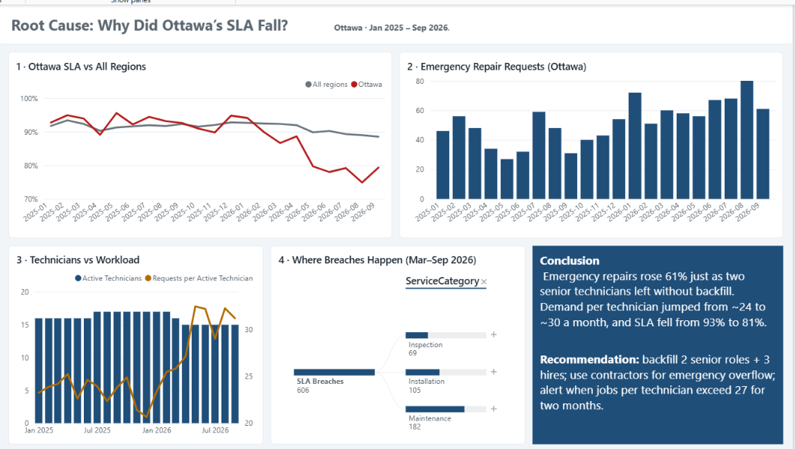
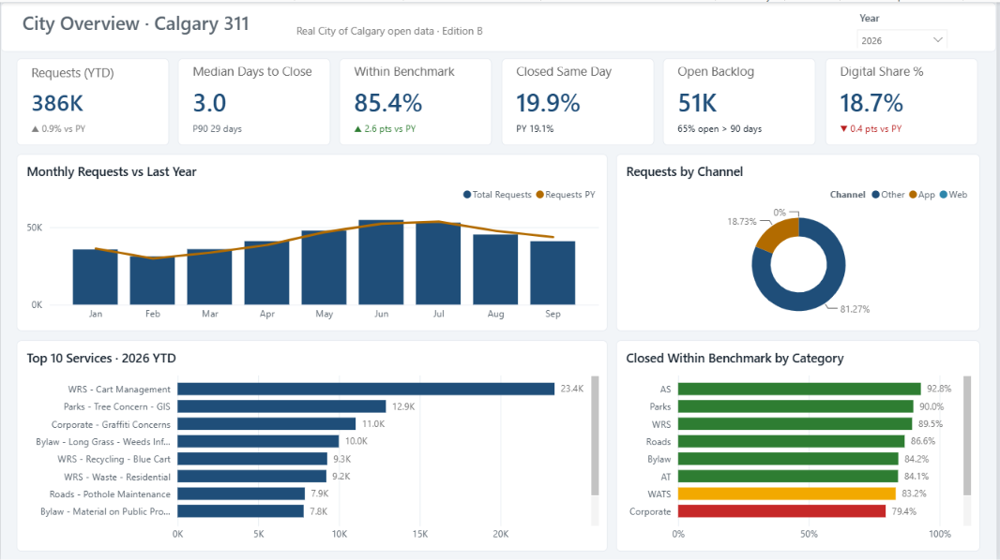
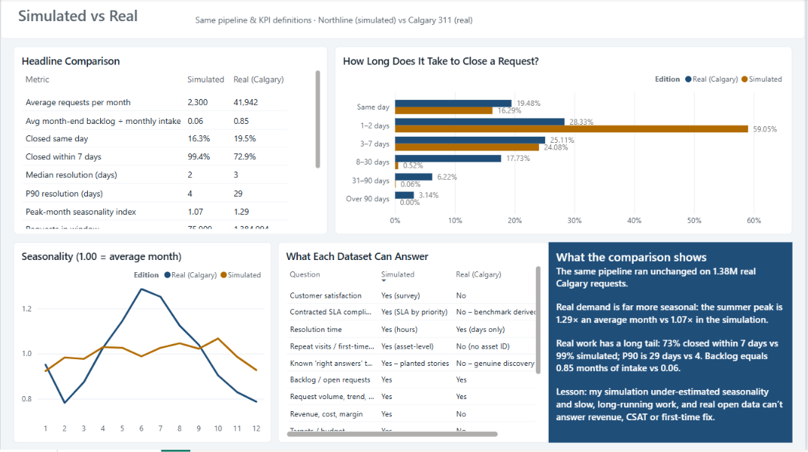
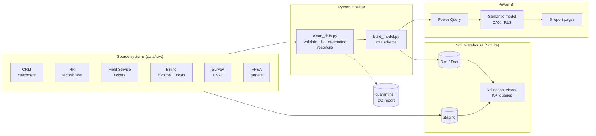

# Enterprise Field Service Performance & Executive KPI Analytics Platform

An end-to-end business-intelligence project built in **two editions that share one pipeline, one data-model design and one set of KPI definitions**:

| | Edition A – Simulated enterprise | Edition B – Real public data |
|---|---|---|
| Data | **Northline Field Services** (fictional): 77K service requests from 5 disconnected systems, with planted data defects and business stories | **City of Calgary 311 Service Requests** (Open Calgary), Jan 2024 – Sep 2026 |
| Why | Full business view (revenue, margin, technicians, CSAT, targets) **with known answers**, so the analysis can be proven correct | Genuine messiness and genuine insights nobody planted |
| Output | 5-page executive & operations report with RLS and root-cause analysis | 4-page city operations report + **Simulated vs Real** comparison page |

Raw data is profiled, cleaned and reconciled in **Python and SQL**, modelled as a **star schema**, and served through **Power BI** semantic models with **DAX**. The comparison ([`docs/simulated_vs_real.md`](docs/simulated_vs_real.md)) shows where the simulation holds up against reality, where it doesn't, and what each dataset can and cannot answer.

**Stack:** Python (pandas, NumPy, Faker) · SQL (SQLite, ANSI-style) · Power Query (M) · Power BI · DAX · pytest · Git

---

## The business problem

Leadership couldn't answer basic questions because customers lived in the CRM, technicians in HR, tickets in the field-service system, revenue in billing and feedback in a survey tool – and none of them agreed.

This project answers:

- Which regions are missing SLA targets, and **why**?
- Why is backlog increasing?
- Which technicians are most productive – and is the comparison fair?
- Which service types take longest? Which customers generate the most revenue?
- Are repeat visits increasing, and what do they cost?
- Is customer satisfaction falling? What drives month-over-month change?

Full requirements: [`docs/business_requirements.md`](docs/business_requirements.md)

## Key findings

| | Finding | Evidence |
|---|---|---|
| 🔴 | **Ottawa SLA fell from 93% to 81%** while its revenue grew 17% – the region looked like the best performer on revenue alone. | Emergency repairs +61% YoY; two senior technicians left in Feb 2026 without backfill; demand per technician rose from ~24 to ~30 a month. |
| 🟠 | **Repeat visits cost ~$620K a year** in free warranty callbacks and are the second-largest driver of low CSAT (3.5 vs 4.1). | Junior technicians cause repeat visits at 2× the rate of seniors, worst on installations. |
| 🟠 | **Hamilton installation margin dropped from 53.5% to 41.3%** without any change in revenue. | Parts cost per job +44% after a supplier change; the billing price list was never updated. |
| 🟡 | Tickets raised **Friday afternoon or Saturday** meet SLA 84% of the time vs 93% otherwise. | 12% of non-critical jobs, ~24% of all breaches. |

Write-up with recommendations: [`docs/analysis_findings.md`](docs/analysis_findings.md)




## Key findings – Edition B (real Calgary 311 data)

| | Finding |
|---|---|
| 📈 | **1.38M real service requests** (Jan 2024 – Sep 2026), about 42K a month. Demand is strongly seasonal: summer runs at **1.29×** an average month, winter at about 0.8×. |
| ⏱️ | Median time to close is **3 days**, but the tail is long: **P90 is 29 days**, and only 73% close within a week. |
| ✅ | **85.4%** of 2026 requests closed within their service benchmark (each service's 2024 P80), **+2.6 pts** on 2025, so the city is getting faster. |
| ⚠️ | **51K requests were open** at 30 Sep 2026, and **65% of them were older than 90 days**. That's stale backlog, or tickets never closed in the system: a data-governance question as much as an operations one. |
| 🔍 | Data limitation: **81% of requests have the channel "Other"**, so channel analysis is weak. Ticket IDs repeat when records are updated, and text codes like `NA` must be read as text, not as missing. |




### What the comparison taught me
The same pipeline ran unchanged on simulated and real data. The simulation got the *shape* of the operation right (volumes, backlog behaviour, data-quality checks) but **under-estimated seasonality** (1.07× vs 1.29× peak) and **long-running work** (P90 4 vs 29 days; backlog 0.06 vs 0.85 months of intake). Real open data, in turn, can't answer revenue, CSAT or first-time-fix questions. Full comparison: [`docs/simulated_vs_real.md`](docs/simulated_vs_real.md).

## Architecture



## Data model

```
                         DimDate  (Created · Closed · Month · Snapshot)
                            │
 DimCustomer ──┐            │            ┌── DimServiceType
 DimTechnician ┼──  FactServiceRequests  ┼── DimPriority
 DimRegion ────┘   (1 row per request)   │
     │                                    
     ├── FactTargets          (region × month budget)
     └── FactBacklogSnapshot  (region × month-end, semi-additive)
```

- **~76K service requests**, Jan 2024 – Sep 2026, 1,400 customers, ~110 technicians.
- Role-playing date dimension (created vs closed date via `USERELATIONSHIP`).
- Unknown/Unassigned technician members so revenue totals stay complete.
- Periodic snapshot fact for backlog.

Column-level documentation: [`docs/data_dictionary.md`](docs/data_dictionary.md) · KPI definitions: [`docs/kpi_definitions.md`](docs/kpi_definitions.md)

## Data quality

The raw extracts deliberately contain the defects real data has. The pipeline fixes what is unambiguous, quarantines what is not, and never drops a row silently.

| Defect | Handling |
|---|---|
| Duplicate tickets, invoices, customers | Removed, counted |
| Inconsistent region names (`Tor.`, `K-W`, `Missisauga`) | Standardised via mapping |
| Invalid dates (`2025-02-30`, `N/A`) | Quarantined |
| Closed before opened | Quarantined |
| Missing customer ID | Quarantined |
| Closed job with no technician | Kept, mapped to *Unknown* (revenue preserved) |
| Negative costs, orphan invoices | Quarantined |
| CSAT outside 1–5, duplicate survey answers | Quarantined / latest kept |
| Billing vs field-service mismatch | Reconciled both ways and reported |

Generated report: [`docs/data_quality_report.md`](docs/data_quality_report.md). Rows removed are in `data/quarantine/quarantine_records.csv` with a reason code. **27 pytest checks** for Edition A, plus 6 for Edition B (grain, referential integrity, business rules, reconciliation, no-rows-lost) guard the model.

## SQL

| File | What it shows |
|---|---|
| [`create_tables.sql`](sql/create_tables.sql) | Staging vs modelled layers, keys, constraints, indexes |
| [`validation_queries.sql`](sql/validation_queries.sql) | Profiling raw data, strict date validation, orphan detection, revenue reconciliation |
| [`transformations.sql`](sql/transformations.sql) | Views: enriched requests, monthly regional scorecard vs target, fair technician ranking |
| [`kpi_queries.sql`](sql/kpi_queries.sql) | 16 business questions: `LAG` MoM/YoY, rolling ratio-of-sums, Pareto with cumulative windows, median without `MEDIAN()`, seasonality-controlled YoY root cause, capacity analysis |

## Power BI

- [`powerbi/pbip/`](powerbi/pbip/OPEN_ME_FIRST.md) – ready-to-open Power BI Projects (TMDL semantic models) for both editions, generated by `powerbi/build_pbip.py`: tables, relationships, measures, date table and RLS defined as code.
- [`powerbi/POWER_BI_BUILD_GUIDE.md`](powerbi/POWER_BI_BUILD_GUIDE.md) – step-by-step build, page designs, RLS, and a table of expected values to validate your DAX against SQL.
- [`powerbi/measures.dax`](powerbi/measures.dax) – 80+ measures: time intelligence (YTD, FYTD, PY, MoM, rolling), `USERELATIONSHIP`, semi-additive snapshots, volume-weighted targets, `RANKX` with minimum-volume rules, a composite performance score, `SWITCH`/`SELECTEDVALUE` KPI selector, conditional-format colours.
- [`powerbi/power_query.m`](powerbi/power_query.m) – parameterised M for every table, plus a raw-data cleaning query that re-implements the rules in Power Query.
- [`powerbi/northline_theme.json`](powerbi/northline_theme.json) – report theme.

**Pages:** Executive Overview · Operations Performance · Regional Performance · Technician Analysis · Root Cause & Exceptions

## Run it

### Edition A – simulated (data already included)

```bash
python -m venv .venv
# Windows: .venv\Scripts\activate     macOS/Linux: source .venv/bin/activate
pip install -r requirements.txt

python run_pipeline.py      # generate → clean → model → SQL warehouse (≈ 1 minute)
pytest -v                   # data-quality tests
```

Then open Power BI Desktop and follow the build guide. The generated data is already included in `data/`, so you can go straight to Power BI.

### Edition B – real Calgary 311 data (needs internet, one time)

```bash
python src/calgary/download_calgary_311.py      # Open Calgary API, resumable, Jan 2024 – Sep 2026
python src/calgary/run_calgary_pipeline.py      # clean → model → SQL → insights → comparison
pytest -v                                       # Edition A + Edition B tests
```

Outputs: `data/calgary/model/` (star schema), `docs/calgary/` (data-quality report and insights fact sheet), `data/comparison/` + `docs/simulated_vs_real.md` (comparison). Build guide: [`powerbi/calgary/POWER_BI_BUILD_GUIDE_CALGARY.md`](powerbi/calgary/POWER_BI_BUILD_GUIDE_CALGARY.md).

Source: [City of Calgary – 311 Service Requests](https://data.calgary.ca/Services-and-Amenities/311-Service-Requests/iahh-g8bj), Open Government Licence – City of Calgary. The Calgary data has dates but no times, so its resolution times are in days. It has no published SLA either, so each service is measured against a derived benchmark: its 2024 80th-percentile resolution time.

## Repository layout

```
enterprise-service-analytics/
├── run_pipeline.py              one-command rebuild (Edition A)
├── src/
│   ├── calgary/                 Edition B: download, clean, model, SQL, insights
│   ├── compare_editions.py      simulated vs real comparison
│   ├── config.py                business rules: regions, SLAs, pricing, seed
│   ├── generate_data.py         realistic multi-system extracts + injected defects
│   ├── clean_data.py            validate · fix · quarantine · reconcile · DQ report
│   ├── build_model.py           star schema (dims, facts, snapshot, RLS mapping)
│   └── load_warehouse.py        SQLite warehouse + runs all SQL
├── sql/                         DDL, validation, views, KPI queries (+ sql/calgary/)
├── data/
│   ├── raw/                     source extracts (with defects)
│   ├── processed/               cleaned tables + data_quality_log.csv
│   ├── quarantine/              rejected rows with reason codes
│   ├── model/                   star schema CSVs → Power BI
│   ├── sql_output/              result of every named SQL query
│   ├── calgary/                 Edition B data (raw is downloaded, not committed)
│   └── comparison/              simulated vs real metrics
├── powerbi/                     DAX, Power Query, theme, build guides (+ powerbi/calgary/)
├── docs/                        requirements, KPI definitions, data dictionary,
│                                DQ report, findings, interview prep
└── tests/                       33 automated checks (Edition A + Edition B on an offline fixture)
```

## Notes

- Edition A data is synthetic, generated with a fixed seed (`src/config.py`) so results are reproducible. Company, customer and employee names are fictional.
- The extract snapshot is 30 Sep 2026. September 2026 is provisional because invoices lag job completion; `DimDate[IsCompleteMonth]` flags months whose billing has fully posted.
